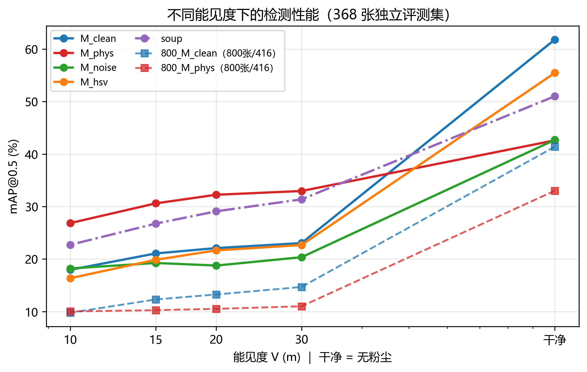

# Mine-Loco Perception

**Physics-guided domain adaptation for underground mine locomotive perception and maintenance**

[中文说明](README.zh-CN.md) · [Docs](docs/) · [Project page](https://jinnn.xyz/mine-loco/) · [Results](docs/results.md)


---

## What this is

Underground mine locomotives have a data problem: dust and low light make cameras blind, but there is
no large labeled dataset from the mine. This repository studies a **physics-guided** way to close that
gap — synthesize dust from the atmospheric scattering model, parameterized by **visibility V**, and
train a detector on the degraded domain. It also contains the **evaluation-protocol fix** that made the
original positive result disappear, and the **scale-up ablation** that made a smaller, physically
specific gain reappear.

The repository is the code behind the Challenge Cup project
*“基于物理引导域适应的井下电机车智能感知与运维系统”* (China University of Mining and Technology).

> **Scope.** Dust is synthetic, ExDark classes are not mine-track obstacles, and the scale-up run is a
> single seed. This is a method and protocol study, **not** a mine-field accuracy claim.

---

## Highlights

1. **Visibility-parameterized degradation.** `β = 3/V`, `t = exp(−βd)`, per-pixel depth from a
   ground-plane projection. The same generator produces clean / V=20 / V=10 training and evaluation
   sets with **disjoint seeds**.
2. **A leakage-free protocol.** The original implementation generated the model-selection set and the
   dust evaluation set from the same split and seed. After the three-way split (train / calibration /
   evaluation), the reported **+3.89 pp** gain did not reproduce: **0/8** comparisons favored the
   physics-trained model at V=20 m.
3. **Scale-up reversal + physical specificity.** At 5000 images / 640 px / 80 epochs, `M_phys` beats
   `M_clean` by **+10.15 / +10.93 pp** at V=20 m and **+8.89 / +10.82 pp** at V=10 m (best / last).
   Two controls — global-gray-aligned noise (`M_noise`) and photometric-only (`M_hsv`) — gain nothing.
   The depth structure is the active ingredient.
4. **Deployment-side options.** TTA lifts `M_phys` to **34.17 mAP@0.5** at V=20 m (+1.93 pp); a
   weight-average “model soup” halves the clean-domain cost (−19.2 → −10.8 pp) while keeping +7.0 pp
   of dust gain. `M_phys` 640 px runs at **~9.2 ms / 109 FPS** on an RTX 5060 Laptop.
5. **A runnable demo.** PySide6 six-page system: perception, robust fusion, LiDAR, health/RUL, replay,
   CSV export, model switch, TTA toggle.

---

## Results



`mAP@0.5 (%)`, 368-image independent evaluation sets, 5000 images / 640 px / 80 epochs:

| Evaluation | M_clean | M_phys | M_noise | M_hsv | Δ phys−clean |
|---|---:|---:|---:|---:|---:|
| Clean | 61.81 | 42.61 | 42.70 | 55.46 | −19.20 |
| V=30 m | 23.04 | **32.96** | 20.35 | 22.67 | +9.92 |
| V=20 m | 22.09 | **32.24** | 18.76 | 21.65 | +10.15 |
| V=15 m | 21.06 | **30.61** | 19.25 | 19.86 | +9.55 |
| V=10 m | 17.96 | **26.85** | 18.20 | 16.35 | +8.89 |

Deployment comparison (`mAP@0.5`):

| Model / inference | Clean | V=20 m | V=10 m |
|---|---:|---:|---:|
| M_clean | 61.81 | 22.09 | 17.96 |
| M_clean + TTA | 61.05 | 21.70 | 17.62 |
| M_phys | 42.60 | 32.24 | 26.85 |
| **M_phys + TTA** | **44.88** | **34.17** | **27.60** |
| soup (weight average) | 51.01 | 29.09 | 22.72 |
| soup + TTA | 54.29 | 30.51 | 24.16 |

The full tables, per-class behavior, and the small-scale (800 images) negative result are in
[docs/results.md](docs/results.md). The evaluation protocol is documented in
[docs/method.md](docs/method.md).

---

## Repository layout

```
mine-loco-perception/
├─ src/mine_loco_system/     # PySide6 demo package (core physics, fusion, LiDAR, health, UI)
├─ scripts/                  # training, evaluation, reproduction, benchmark
├─ tests/                    # 18 pytest checks (physics, fusion, LiDAR, health)
├─ docs/                     # method, results, reproduction, deployment, FAQ
├─ assets/                   # figures and small reference JSONs
├─ site/                     # static project page (deploy to jinnn.xyz)
├─ data/                     # datasets (not committed; see data/README.md)
├─ weights/                  # checkpoints (not committed; see weights/README.md)
└─ outputs/                  # generated cases, runs, results, figures (git-ignored)
```

---

## Quickstart

```bash
git clone https://github.com/<your-org>/mine-loco-perception.git
cd mine-loco-perception
pip install -e ".[full]"          # Python 3.10+; see requirements.txt for pinned versions
pytest -q                         # 18 tests, no data needed

# ExDark (CC BY 4.0) → data/exdark/data
python scripts/download_exdark.py

# Demo system
python -m mine_loco_system.main
```

Place `yolov8n.pt` in `weights/` (Ultralytics can download it automatically on first use). Trained
checkpoints are not committed; `scripts/exp_scaleup_ablation.py` reproduces the four models.

### Reproduce the paper tables

```bash
# Simulation experiments E2/E3/E4
python scripts/rerun_e2_offset.py
python scripts/rerun_e3_lidar.py
python scripts/rerun_e4_lifetime.py
python scripts/sensitivity_check.py
python scripts/redraw_figs.py

# Real-detection experiment (800 images / 416 px / 15 epochs)
python scripts/exp_real_detect_fixed.py --epochs 15 --batch 16

# Scale-up + ablation (5000 images / 640 px / 80 epochs × 4 models; ~8 h on one GPU)
python scripts/exp_scaleup_ablation.py --epochs 80 --batch 16 --imgsz 640

# Extended evaluation: V=30/15, TTA, model soup
python scripts/eval_extension.py
```

`scripts/check_repro_requirements.py` prints a PASS/FAIL checklist for data, weights, GPU and network.

---

## Paths and data

All code resolves paths through `src/mine_loco_system/paths.py`:

| Variable | Default | Meaning |
|---|---|---|
| `MINE_LOCO_DATA` | `data/` | ExDark root: `data/exdark/data/{train,valid}` |
| `MINE_LOCO_WEIGHTS` | `weights/` | `yolov8n.pt`, `m_clean_800/best.pt` |
| `MINE_LOCO_OUTPUTS` | `outputs/` | cases, training runs, results, figures |

Datasets and checkpoints are intentionally **not** committed. See [data/README.md](data/README.md)
and [weights/README.md](weights/README.md).

---

## Project page / web deployment

`site/` is a self-contained static page (no build step, no CDN). Preview locally:

```bash
cd site
python -m http.server 8000
```

To publish it at **jinnn.xyz**, see [docs/deployment.md](docs/deployment.md) for the options:
Cloudflare Pages (recommended), a VPS with Nginx + Certbot, and GitHub Pages with a custom domain.
The repository includes a GitHub Pages workflow (`.github/workflows/pages.yml`) that publishes `site/`.

---

## Citation

```bibtex
@software{mine_loco_perception_2026,
  title  = {Mine-Loco Perception: Physics-Guided Domain Adaptation for
            Underground Mine Locomotive Perception and Maintenance},
  author = {Li, Kerui and Wang, Zhiwen and Yang, Moran and Jin, Zikuan and
            Qi, Gaoyang and Xia, Yuhan and Liu, Yixuan},
  year   = {2026},
  url    = {https://github.com/<your-org>/mine-loco-perception}
}
```

See [CITATION.cff](CITATION.cff) for the machine-readable record.

---

## License and acknowledgements

- Code: **MIT** (see [LICENSE](LICENSE)).
- ExDark dataset: **CC BY 4.0**, © its original authors. Please cite ExDark if you use the data.
- Dust degradation is synthetic; no real mine images are included.
- The PySide6 demo and experiment scripts were developed for a student competition; competition
  documents, personal data, and unpublished patent drafts are **not** part of this repository.
